# Screenshot galleries

The [Johnny.Decimal macOS gallery](johnny-decimal/macos/README.md) compares the
built-in folder-structure tools with the plugin's additional capabilities.

## Windows

The Windows captures show a collection of 60 real files being sorted into an
existing library: photos, park guides, books, research data, fonts, videos, and
free software. Select an image to open the full-size capture.

The [animated walkthrough](ai-file-sorter-win.gif) follows the same workflow in
44 seconds, with pauses on the key steps. Its header reads “Sorting stray files
into existing folders”, and its source and destination are `D:\Files\Downloads`
and `D:\Files\Library`.

<table>
  <thead>
    <tr><th>Windows — English</th><th>Windows — Français</th></tr>
  </thead>
  <tbody>
    <tr>
      <td>
<strong>1. Start with a mixed Downloads folder</strong>
<a href="aifs-main-window-win.png">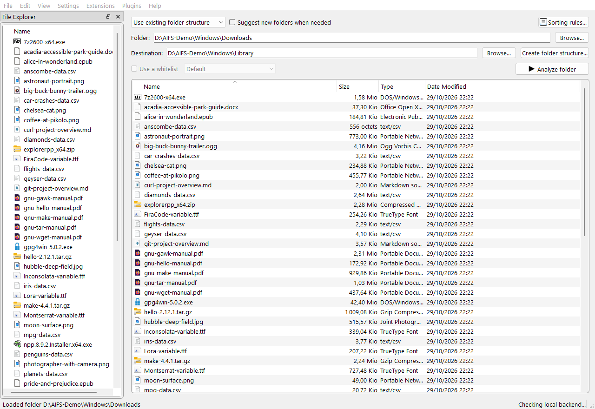</a></td>
      <td>
<strong>1. Choisir le dossier de téléchargements</strong>
<a href="fr/aifs-main-window-win.png">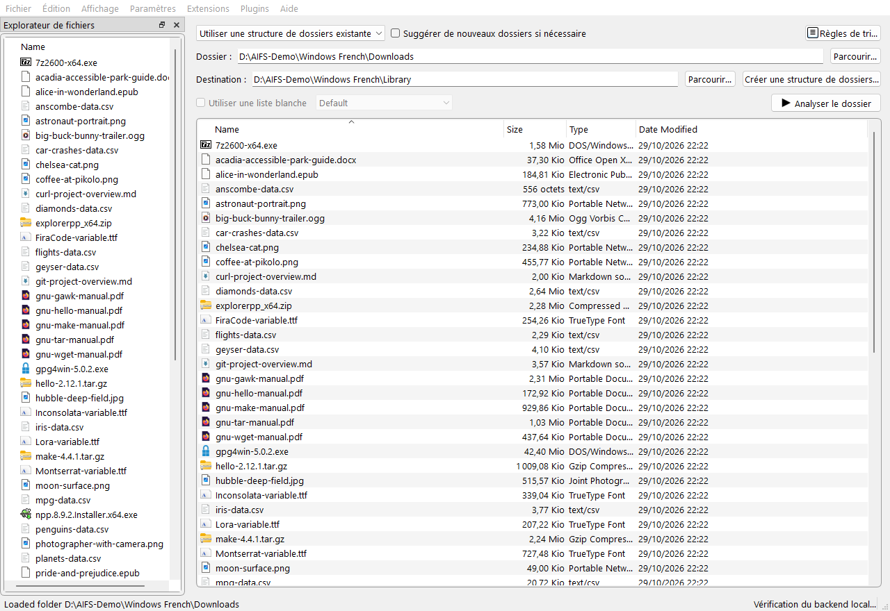</a></td>
    </tr>
    <tr>
      <td>
<strong>2. Use an existing folder structure</strong>
<a href="aifs-folder-tree-win.png">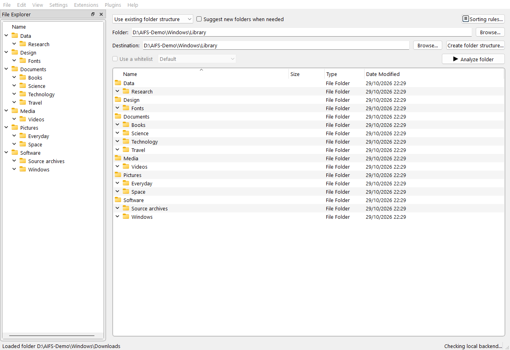</a></td>
      <td>
<strong>2. Utiliser une arborescence existante</strong>
<a href="fr/aifs-folder-tree-win.png">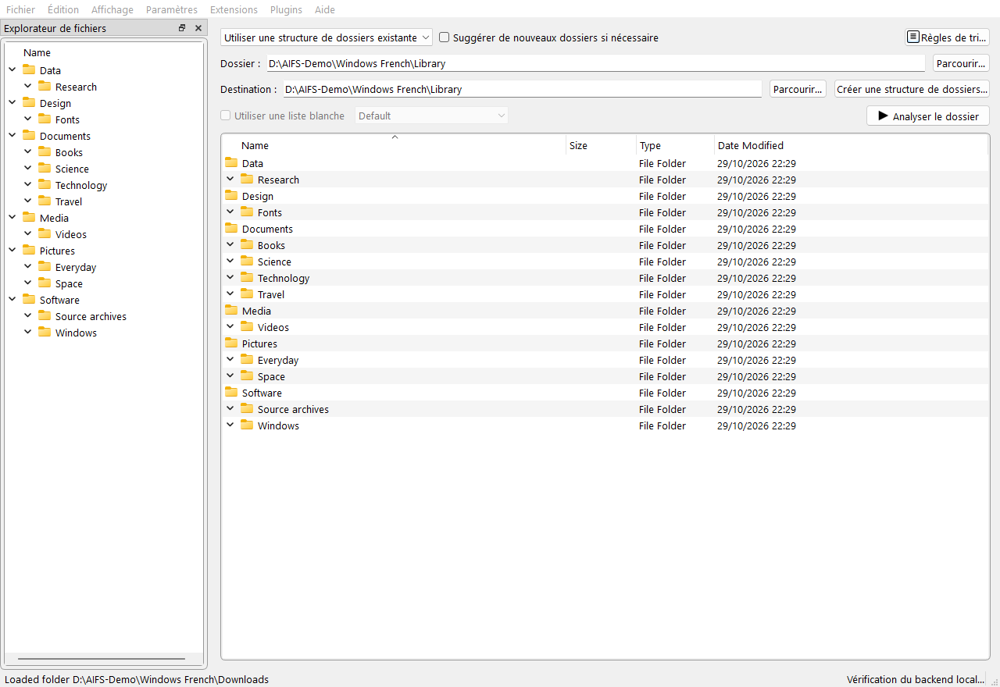</a></td>
    </tr>
    <tr>
      <td>
<strong>3. Choose a model</strong>
<a href="llm-select-win.png">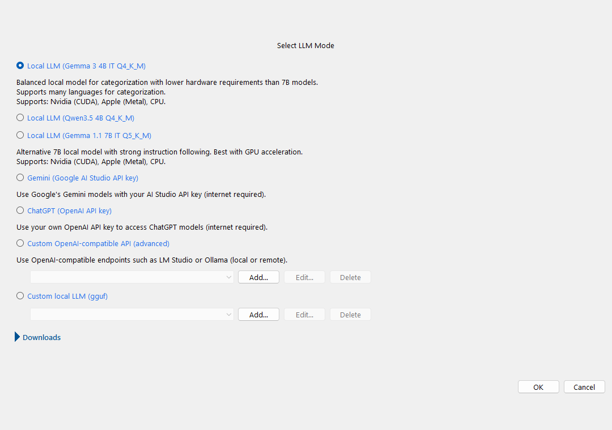</a></td>
      <td>
<strong>3. Choisir un modèle</strong>
<a href="fr/llm-select-win.png">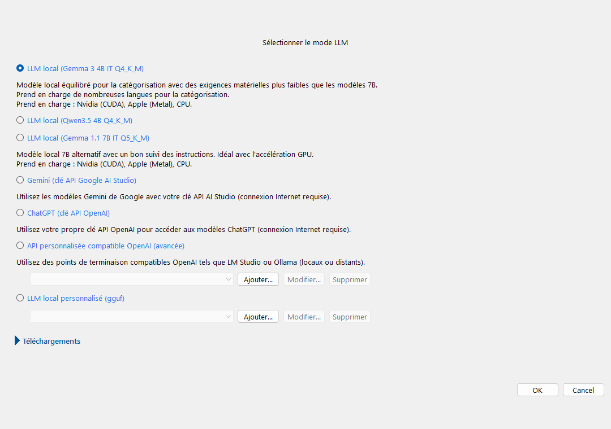</a></td>
    </tr>
    <tr>
      <td>
<strong>4. Follow content analysis</strong>
<a href="aifs-progress-dialog-win.png">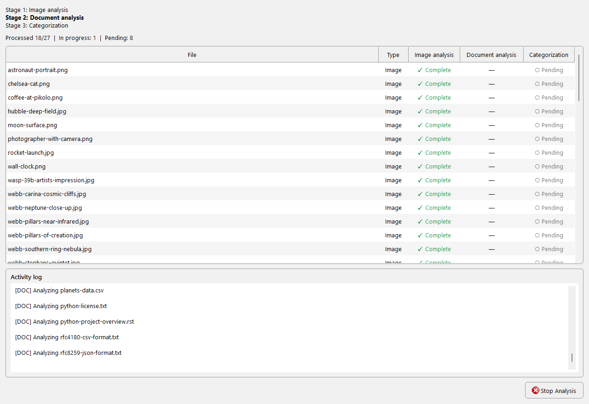</a></td>
      <td>
<strong>4. Suivre l’analyse du contenu</strong>
<a href="fr/aifs-progress-dialog-win.png">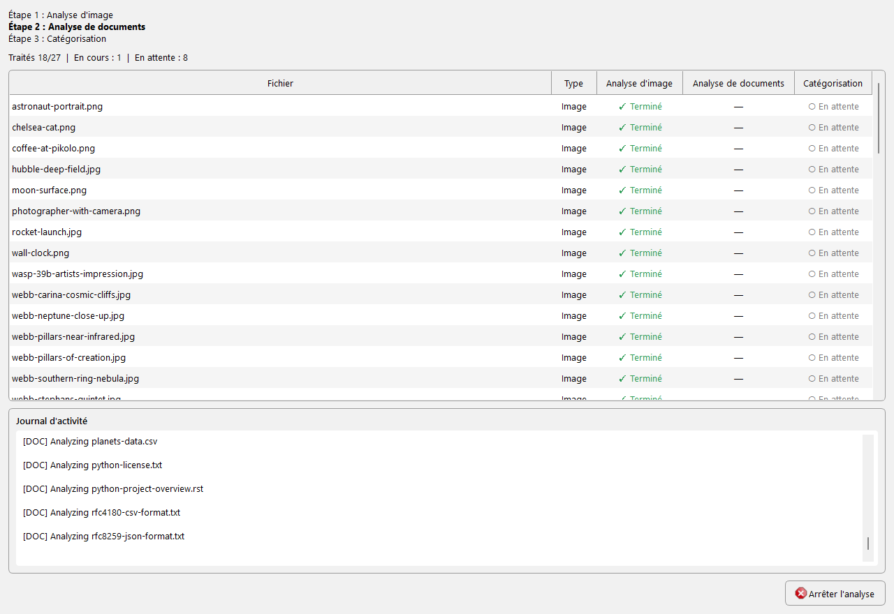</a></td>
    </tr>
    <tr>
      <td>
<strong>5. Review names and destinations</strong>
<a href="aifs-review-dialog-win.png">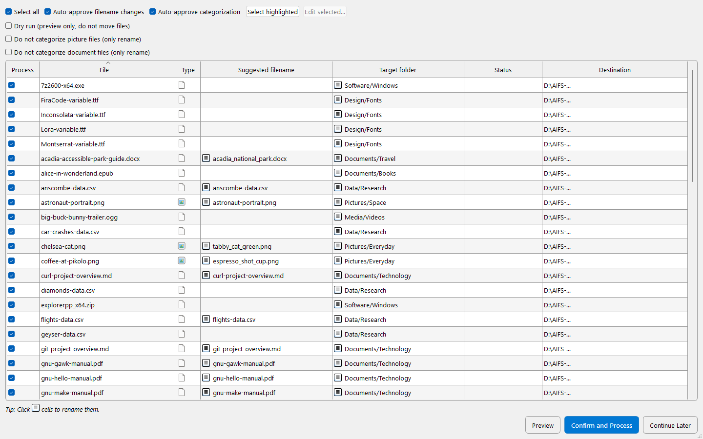</a></td>
      <td>
<strong>5. Vérifier les noms et les destinations</strong>
<a href="fr/aifs-review-dialog-win.png">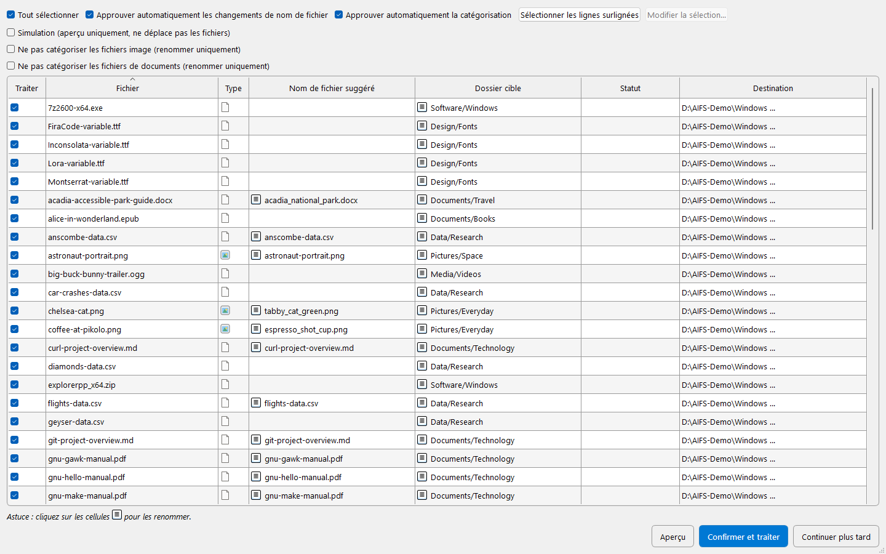</a></td>
    </tr>
    <tr>
      <td>
<strong>6. Preview the complete move plan</strong>
<a href="aifs-dry-run-win.png">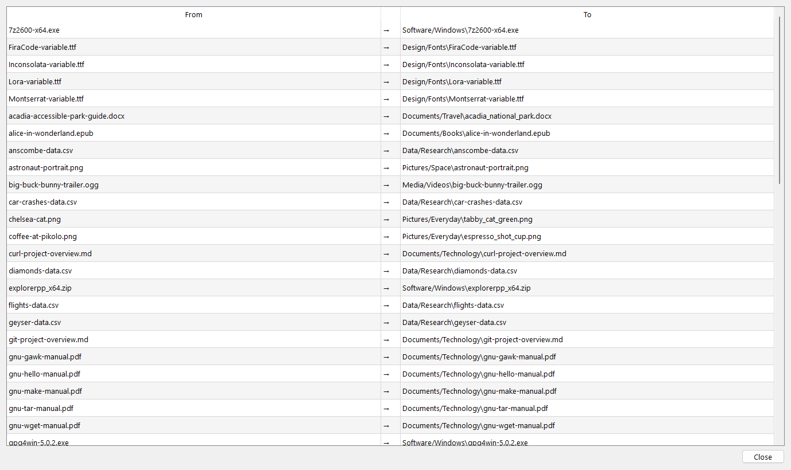</a></td>
      <td>
<strong>6. Prévisualiser les déplacements</strong>
</td>
    </tr>
    <tr>
      <td>
<strong>7. Confirm and check the results</strong>
<a href="sort-confirm-moved-win.png">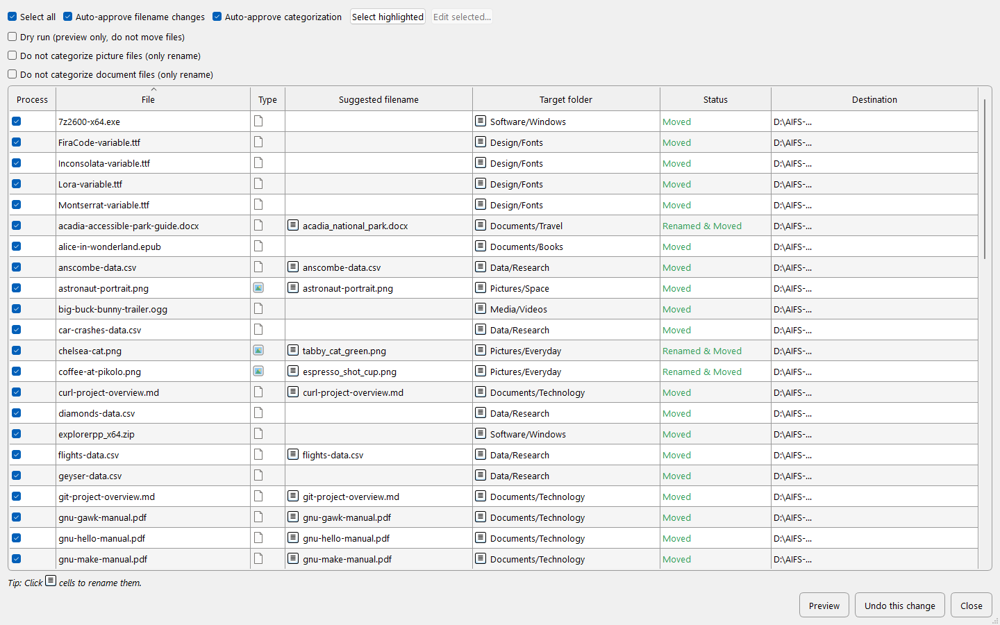</a></td>
      <td>
<strong>7. Confirmer et vérifier le résultat</strong>
<a href="fr/sort-confirm-moved-win.png">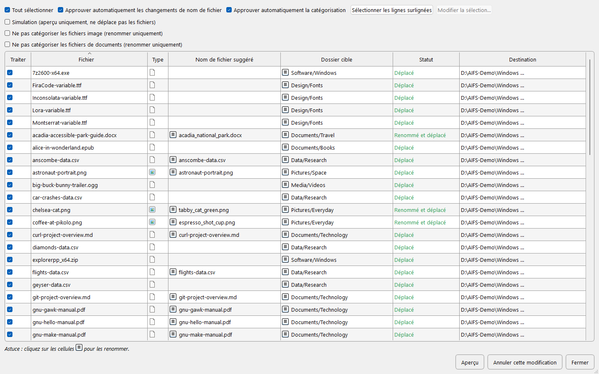</a></td>
    </tr>
    <tr>
      <td>
<strong>8. Browse the organized library</strong>
<a href="aifs-organized-library-win.png">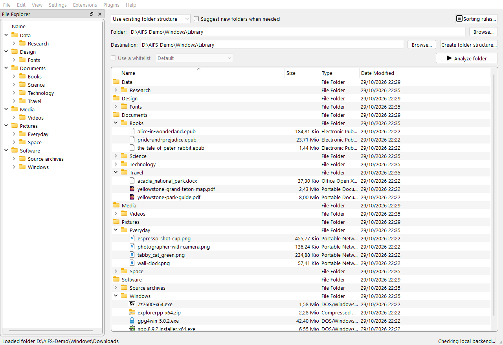</a></td>
      <td>
<strong>8. Parcourir la bibliothèque organisée</strong>
<a href="fr/aifs-organized-library-win.png">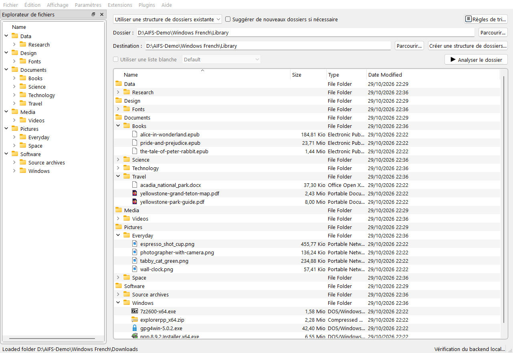</a></td>
    </tr>
  </tbody>
</table>

These native Windows captures were refreshed on 29 October 2026 using an isolated
sample collection. Local model suggestions were reviewed before applying changes.
The progress views replay recorded events from the real local-model analysis;
the GIF identifies the replay and removed waits. The app performed the dry run
and all 60 confirmed moves, and the resulting file contents and destination
folders were verified.
