# Johnny.Decimal on macOS

These native app captures show what enabling the Johnny.Decimal Support plugin
adds to AI File Sorter's existing folder-structure tools. Click an image for the
original Retina capture. The comparison views use the same archive, whose
intentionally invalid folders are kept separate from the working library.

| Built into the app | With the Johnny.Decimal plugin enabled |
| --- | --- |
| **Starter template.** A Johnny.Decimal-like starter is already included. [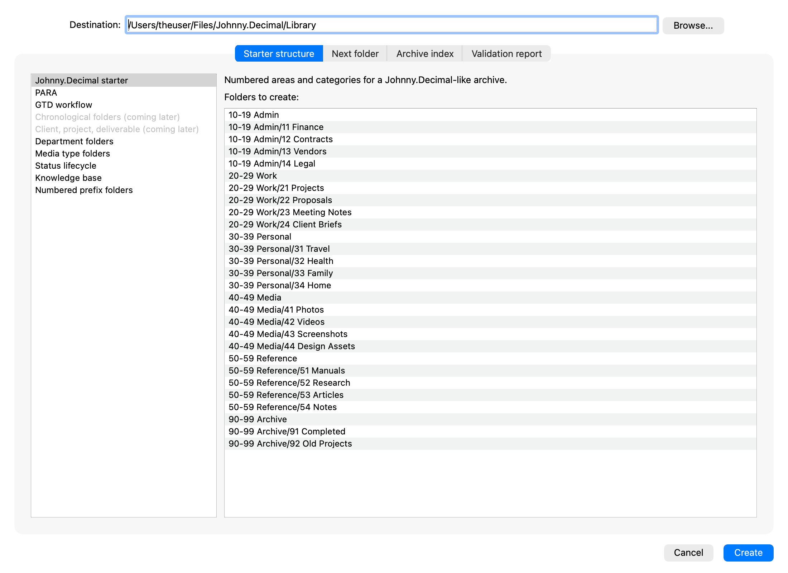](without-plugin-starter.png) | **Additional Complete template.** The verified plugin contributes its own System, Admin, Work, Personal, Reference, and Archive folders and routing guidance. The list labels this template “(plugin)”. [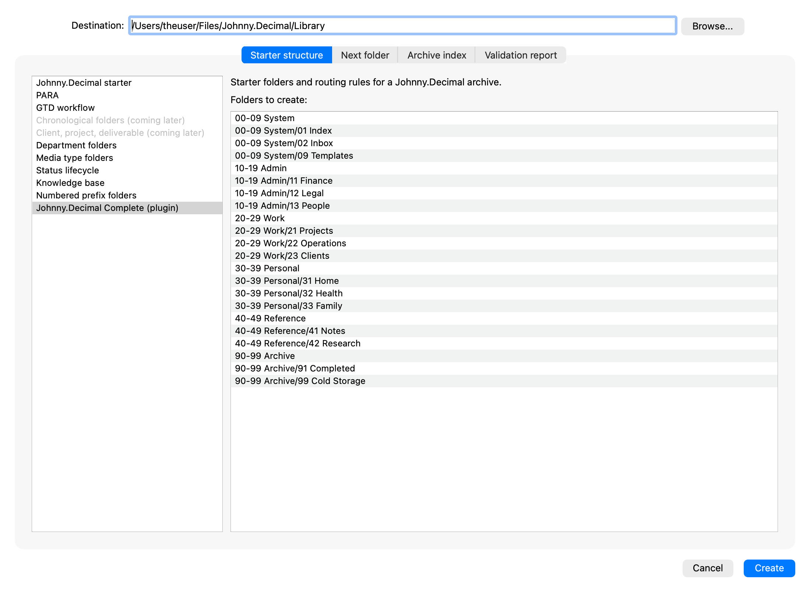](starter-structure.png) |
| **Plain-text archive index.** Displays the numbered hierarchy. [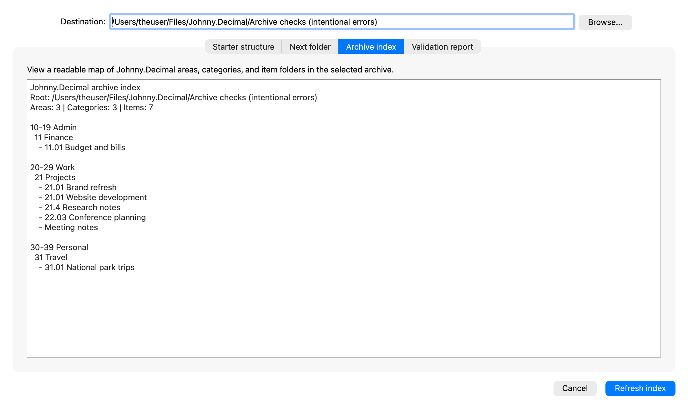](without-plugin-index.png) | **Interactive archive index.** Adds ID/name search, item-ID status indicators, folder opening, and linked Markdown export. Duplicate, malformed, misplaced, and missing IDs are visible here. [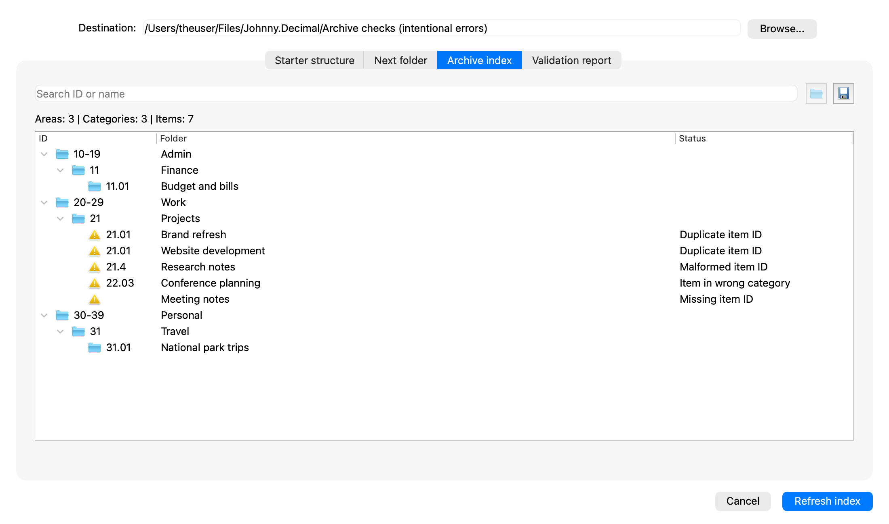](archive-index.png) |
| **Area and category validation.** The structure passes these checks; the report does not inspect item IDs. [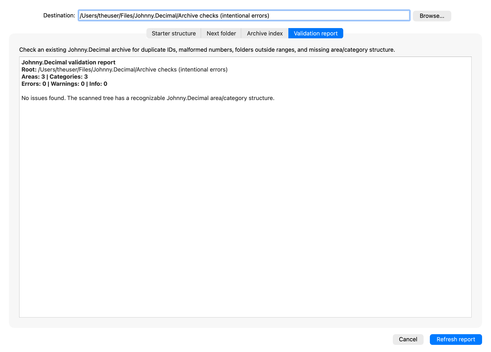](without-plugin-validation.png) | **Item-ID validation.** The same archive produces four errors and one warning across seven item folders, with details and suggested fixes. [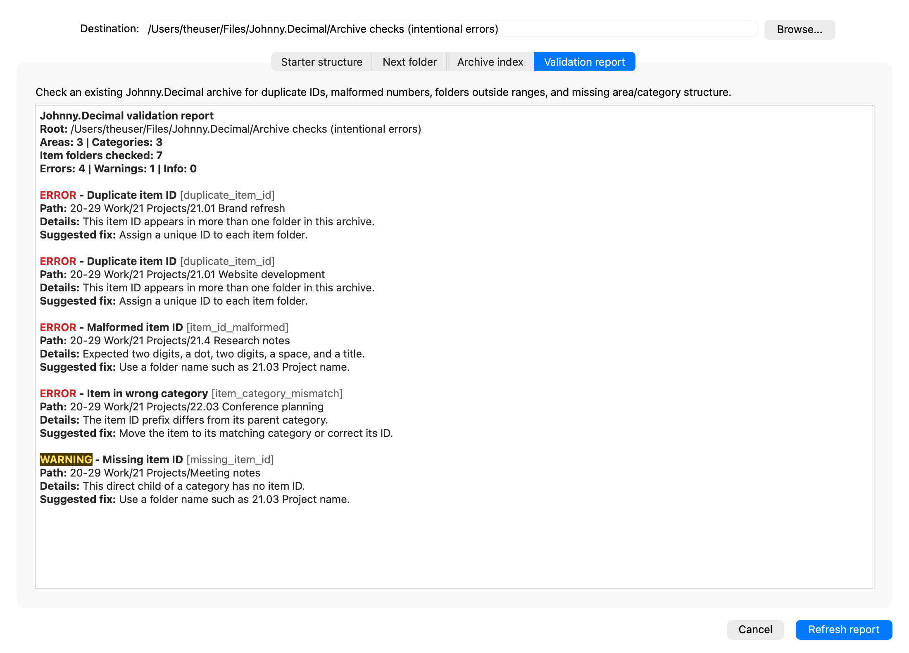](validation-report.png) |

**Search by item ID.** Searching `21.01` retains its parent hierarchy and reveals
both folders using that ID. Selecting a result enables the folder-opening action.

**Export the complete index.** The export action produces linked Markdown for
the full folder snapshot, including folders with invalid or missing IDs. Filtering does not limit
the export. See the [example Markdown export](archive-index.md).

[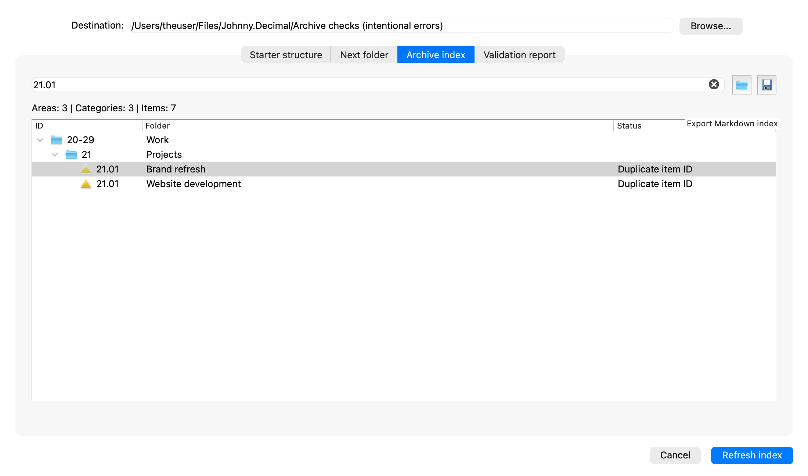](archive-export.png)

**Verified and active.** The installed package has a verified publisher, enabled
status, and an active signed entitlement. No license key or receipt is displayed.

[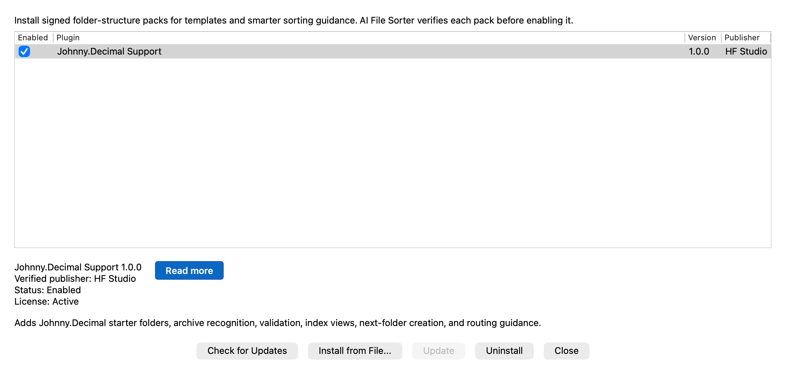](activation-install.png)

**Routing with the plugin.** The plugin contributes guidance to preserve existing
IDs, prefer existing numbered categories, and use folder meanings rather than
numbers alone. Existing-folder routing and routing explanations are also
available in the base app; an explanation is not proof of perfect classification.
This capture uses a fresh local-model analysis with the verified plugin enabled.

[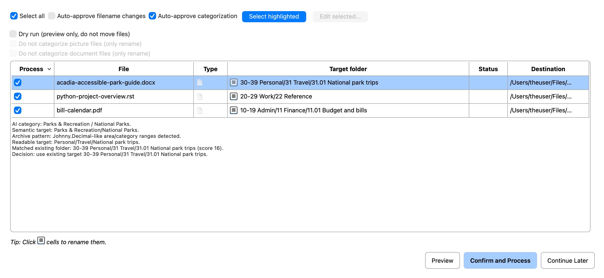](routing-explanations.png)

**Shared next-folder workflow.** Number allocation, preview, and collision checks
are built-in tools. This view is included as workflow context, not a feature
exclusive to the plugin.

[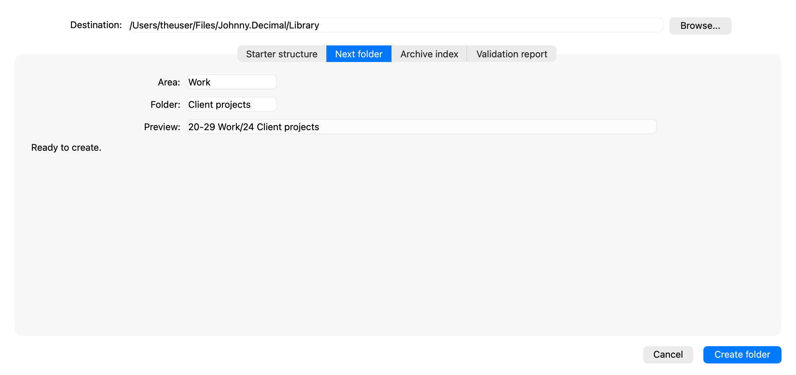](next-folder.png)

**Before installation.** The base app detects an existing Johnny.Decimal-like
archive and offers the plugin. This capture uses a separate unactivated profile.

[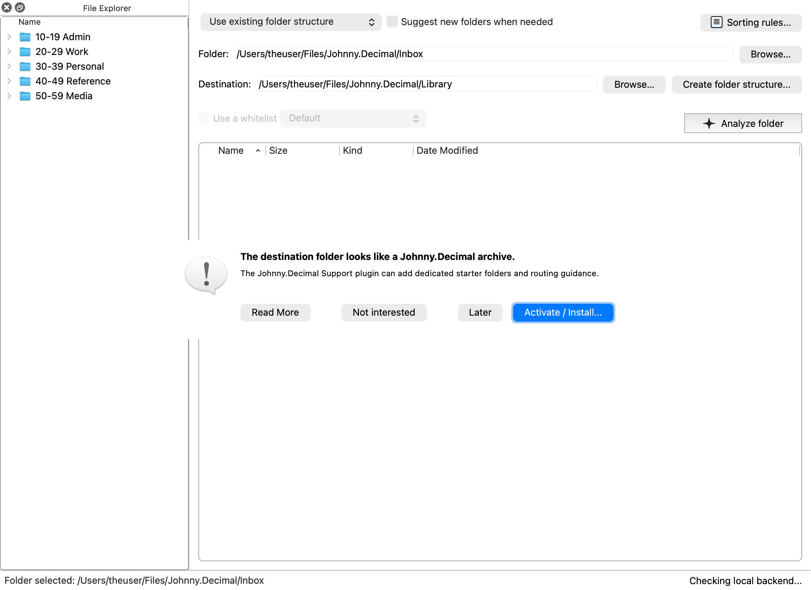](plugin-suggestion.png)

Captured on 30 October 2026 from the macOS app's actual Qt widgets. Enabled-plugin
views load a signed package and verify an existing device-bound entitlement in
an isolated capture profile. Comparison dialogs receive no plugin profile.
The archive examples contain real folders; the routing examples analyze public
documents. Capture tooling and provenance are documented in the sibling
`filesorter_web/tools/jd_macos/README.md`. Application behavior was not changed
for these screenshots.
